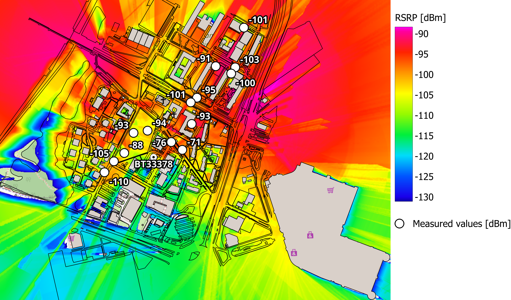
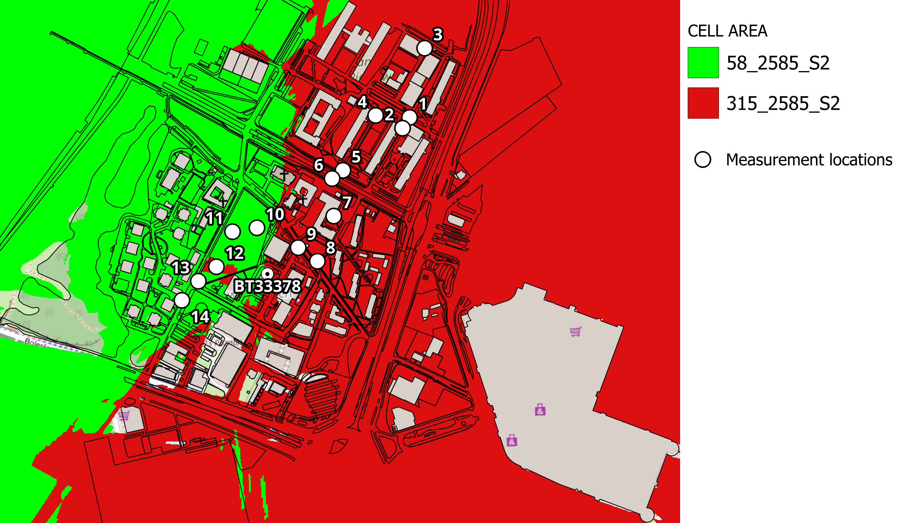
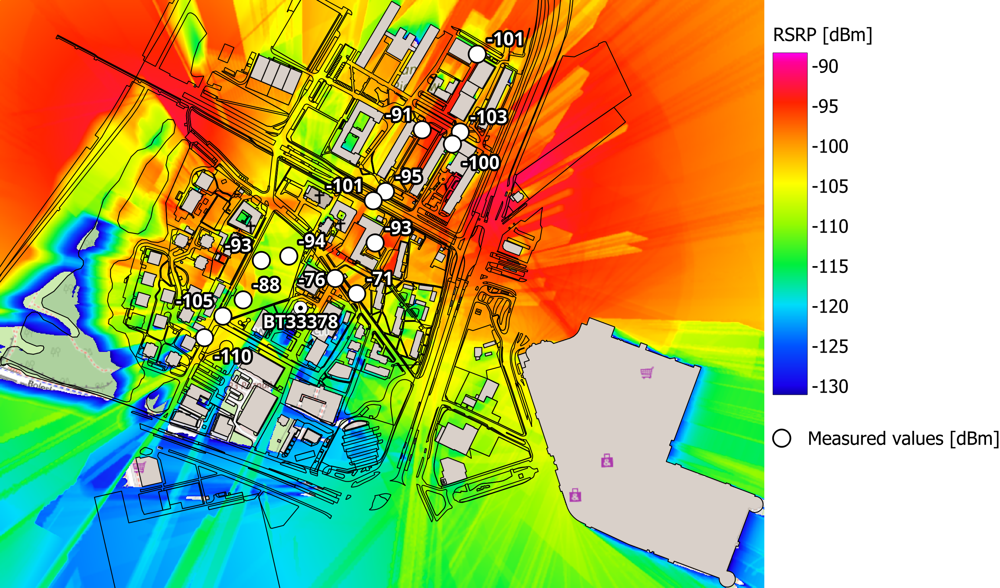
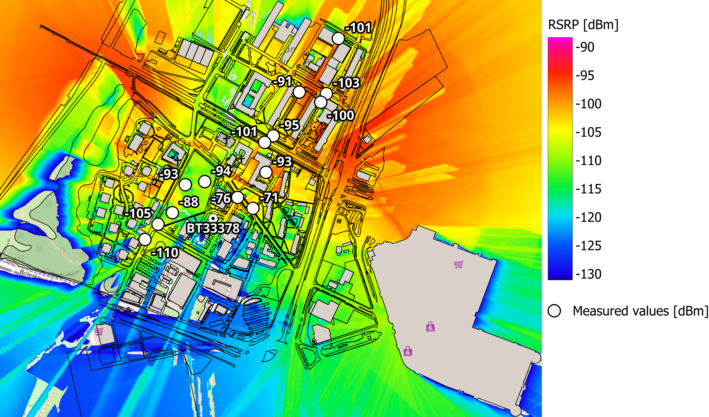

# LTE-B38-PUT-Campus-WinProp

The aim of this project was to compare LTE Band 38 (2600 MHz) radio coverage and signal propagation simulation results from Altair WinProp with real-world measurements. The studied base station, BT33378, belongs to the Polish mobile network Plus, operated by Polkomtel Sp. z o.o., and is located at Student Dormitory No. 5 (DS5) of Poznań University of Technology, at 11A Św. Rocha Street in Poznań, Poland.

The project also tries to answer three questions:

1. How well do WinProp simulations match real LTE measurements despite model simplifications?
2. How does MIMO affect network performance, and which configuration gives results closest to real measurements?
3. How does calibration using real-world measurements affect the simulation results?

### 1. Input Data Sources
* **OpenStreetMap** - map and urban area data used to prepare the simulation environment.
* **BTSearch** - map used to locate base station BT33378.
* **SI2PEM** - public database providing base station locations, technologies, frequency bands, and measurement reports, including antenna parameters such as azimuth, height, and downtilt.
* **Altair WinProp examples**
  * `LTE_Band38_BW_20MHz_TDD.wst` - used as the LTE TDD air interface template with a 20 MHz channels at 2585 and 2604.8 MHz.
  * `WiMax_2500MHz_60deg.apb` - used as an approximate 2600 MHz sector antenna pattern.
* **Field measurements** – real LTE signal measurements collected using the NetMonster app.
* **QGIS** - used to prepare measurement locations and compare real measurements with simulation results.

### 2. Field Measurement Results

LTE signal measurements were taken at 14 locations near base station BT33378 on October 19, 2026, between 09:52 and 10:23, using a smartphone with the NetMonster app. The phone received LTE Band 38 signals from three cells operating at two carrier frequencies: **2585 MHz** and **2604.8 MHz**. The measurements included RSSI, RSRP, RSRQ, SNR, GPS coordinates and cell information.

The following cells were identified:

| Band | eNBID | CLID | ECI | PCI | EARFCN | Frequency |
|---|---:|---:|---:|---:|---:|---:|
| B38 | 233378 | 1 | 59744769 | 364 | 37900 | 2585 MHz |
| B38 | 233378 | 3 | 59744771 | 180 | 38098 | 2604.8 MHz |
| B38 | 233378 | 4 | 59744772 | 364 | 38098 | 2604.8 MHz |

The measured values and corresponding WinProp simulation results for SISO, MIMO 2×2 and MIMO 4×4 are saved in Measurements_vs_Simulation.xlc.

### 3. Urban Database Preparation and Preprocessing in WallMan

The urban environment was prepared in **WallMan** using OpenStreetMap data (`map.osm`). The imported data were converted into a WinProp urban database (`map.odb`) representing buildings and the surrounding environment. The database was then preprocessed using **Intelligent Ray Tracing (IRT)** to generate the `map.oib` file and improve propagation simulation efficiency in ProMan.

### 4. Simulation Configuration in ProMan

The LTE network was configured in **Altair WinProp ProMan** using the following parameters.

#### Air Interface and Network Settings

- **Technology:** 4G LTE
- **Multiple access:** OFDM / SOFDMA
- **Band:** LTE Band 38 (2600 MHz)
- **Duplex:** TDD
- **Carrier frequencies:** 2585 MHz and 2604.8 MHz
- **Channel bandwidth:** 20 MHz per carrier
- **Cell assignment:** Highest Rx power of all carriers in the network
- **Minimum required SNIR:** -5.4 dB

#### Propagation and Simulation Settings

- **Propagation model:** Intelligent Ray Tracing (IRT)
- **Prediction height:** 1.5 m
- **Prediction resolution:** 1 m

### 5. Base Station and Antenna Configuration

Base station BT33378 was configured in **ProMan** using antenna parameters from SI2PEM, including azimuth, height, and downtilt.

#### Antenna Sectors

The simulation included two antenna sectors:

| Sector | Azimuth | Downtilt | Antenna height |
|---|---:|---:|---:|
| Sector 1 | 315° | 3.5° | 40 m |
| Sector 2 | 58° | 2.5° | 40 m |

#### Antenna Parameters

- **Antenna pattern:** `WiMax_2500MHz_60deg.apb`
- **Antenna gain:** 17 dBi
- **Polarization:** Linear +45° (SISO), ±45° (MIMO)

The antenna pattern was used as an approximate model for the 2600 MHz band.

#### MIMO Configuration

Three configurations were simulated to compare network performance, with the EIRP per antenna element adjusted to maintain approximately the same total EIRP across all configurations.

| Configuration | EIRP per antenna element |
|---|---:|
| SISO | 50 dBm |
| MIMO 2×2 | 47 dBm |
| MIMO 4×4 | 44 dBm |

For MIMO, ideal separation of spatial streams (no inter-stream interference) was assumed.

### 6. Simulation Results - Variant A: SISO

The simulation results were compared with field measurements at the same locations. However, the measured and simulated values do not always come from the same cell or frequency.

The simulation included 2585 MHz and 2604.8 MHz, but only 2585 MHz cells appeared in the Cell Area map. In contrast, only measurement points 1, 2, and 4 used 2585 MHz. The remaining points used 2604.8 MHz. For this reason, the comparison focuses on signal values at the same locations, rather than on matching the same LTE cells and carrier frequencies.

#### 6.1. Cell Area Assignment

The Cell Area maps show the coverage of individual cells predicted by WinProp, based on the highest received power among all carriers.

These maps are very similar across all three configurations. The MIMO variants, especially MIMO 4×4, show slightly smaller sector coverage areas and a few small gaps. However, the overall coverage pattern remains almost unchanged.

#### 6.2. Reference Signal Received Power (RSRP)

RSRP measures the average received power of LTE reference signals transmitted by the base station. It is used to evaluate signal strength and network coverage. The measured RSRP values are marked at the measurement locations.

### 7. Simulation Results - Variant B: MIMO 2×2

#### 7.1. Cell Area Assignment

#### 7.2. Reference Signal Received Power (RSRP)

### 8. Simulation Results - Variant C: MIMO 4×4

#### 8.1. Cell Area Assignment

#### 8.2. Reference Signal Received Power (RSRP)

