# LTE-B38-PUT-Campus-WinProp

The aim of this project was to compare LTE Band 38 (2600 MHz) radio coverage and signal propagation simulation results from Altair WinProp with real-world measurements. The analyzed base station, BT33378, belongs to the Polish mobile network Plus, operated by Polkomtel Sp. z o.o., and is located at Student Dormitory No. 5 (DS5) of Poznań University of Technology, at 11A Św. Rocha Street in Poznań, Poland.

The project also aims to answer three questions:

1. **How well do WinProp simulations match real LTE measurements despite model simplifications?**
2. **Which configuration (SISO, MIMO 2×2, or MIMO 4×4) achieves the best simulation results?**
3. **Which configuration (SISO, MIMO 2×2, or MIMO 4×4) gives results closest to real measurements?**

## 1. Input Data Sources

- **OpenStreetMap** - map data used to prepare the simulation environment.
- **BTSearch** - used to identify the location of base station BT33378.
- **SI2PEM** - used to obtain base station and antenna parameters, including azimuth, height, and downtilt.
- **Altair WinProp example files:**
  - `LTE_Band38_BW_20MHz_TDD.wst` - used as the LTE TDD air interface template.
  - `WiMax_2500MHz_60deg.apb` - used as an approximate sector antenna pattern.
- **Field measurements** - real LTE signal measurements collected using the NetMonster app.

## 2. Field Measurement Results

LTE signal measurements were taken at 14 locations near base station BT33378 on October 19, 2026, between 09:52 and 10:23, using a smartphone with the **NetMonster app**. The phone received LTE Band 38 signals from three cells operating at two carrier frequencies: **2585 MHz** and **2604.8 MHz**. The measurements included RSSI, RSRP, and RSRQ.

The following cells were identified:

| Band | eNBID | CLID | ECI | PCI | EARFCN | Frequency |
|---|---:|---:|---:|---:|---:|---:|
| B38 | 233378 | 1 | 59744769 | 364 | 37900 | 2585 MHz |
| B38 | 233378 | 3 | 59744771 | 180 | 38098 | 2604.8 MHz |
| B38 | 233378 | 4 | 59744772 | 364 | 38098 | 2604.8 MHz |

The measured values and corresponding WinProp simulation results for SISO, MIMO 2×2 and MIMO 4×4 are saved in [Measurements_vs_Simulation.xlsx](data/Measurements_vs_Simulation.xlsx).

## 3. Urban Database Preparation and Preprocessing in WallMan

The urban environment was prepared in **WallMan** using OpenStreetMap data ([map.osm](data/map.osm)). The imported data were converted into a WinProp urban database ([map.odb](data/map.odb)) representing buildings and the surrounding environment. The database was then preprocessed using **Intelligent Ray Tracing (IRT)** to generate the [map.oib](https://github.com/judyta-ferenc/LTE-B38-PUT-Campus-WinProp/releases/download/v1.0/map_oib.rar) file and improve propagation simulation efficiency in ProMan.

## 4. Simulation Configuration in ProMan

The LTE network was configured in **Altair WinProp ProMan** using the following parameters.

### LTE Network Settings

- **Technology:** 4G LTE
- **Band:** LTE Band 38 (2600 MHz)
- **Multiple access:** OFDM / SOFDMA
- **Duplex:** TDD
- **Carrier frequencies:** 2585 MHz and 2604.8 MHz
- **Channel bandwidth:** 20 MHz per carrier
- **Cell assignment:** Highest Rx power of all carriers in the network
- **Minimum required SNIR:** -5.4 dB

### Propagation Settings

- **Propagation model:** Intelligent Ray Tracing (IRT)
- **Prediction height:** 1.5 m
- **Prediction resolution:** 1 m

## 5. Base Station and Antenna Configuration

Base station BT33378 was configured in **ProMan** using antenna data from SI2PEM.

### Antenna Sectors

Two antenna sectors were included in the simulation:

| Sector | Azimuth | Downtilt | Height |
|---|---:|---:|---:|
| Sector 1 | 315° | 3.5° | 40 m |
| Sector 2 | 58° | 2.5° | 40 m |

### Antenna Parameters

- **Antenna pattern:** `WiMax_2500MHz_60deg.apb`
- **Antenna gain:** 17 dBi
- **Polarization:** Linear +45° (SISO), ±45° (MIMO)

The antenna pattern was used as an approximate model for the 2600 MHz band.

### MIMO Configuration

Three configurations were simulated to compare network performance. The EIRP per antenna element was adjusted to keep approximately the same total EIRP.

| Configuration | EIRP per antenna element |
|---|---:|
| SISO | 50 dBm |
| MIMO 2×2 | 47 dBm |
| MIMO 4×4 | 44 dBm |

For MIMO, no interference between spatial streams was assumed.

## 6. Simulation Results and Comparison

### 6.1. Cell Area Assignment

The cell area maps show the coverage of individual cells predicted by WinProp, based on the highest received power among all carriers.

The simulation included 2585 MHz and 2604.8 MHz, but only 2585 MHz cells appeared in the cell area maps. In contrast, only measurement points 1, 2, and 4 used 2585 MHz. As a result, the comparison does not always involve the same LTE cells or carrier frequencies, which limits its accuracy. However, the measured and simulated values at the same locations were compared to identify general differences and possible reasons for them.

The cell area maps are very similar across all three configurations. The MIMO variants, especially MIMO 4×4, show slightly smaller coverage areas and a few small gaps. However, the overall coverage remains almost the same.

| SISO | MIMO 2×2 | MIMO 4×4 |
|:---:|:---:|:---:|
| 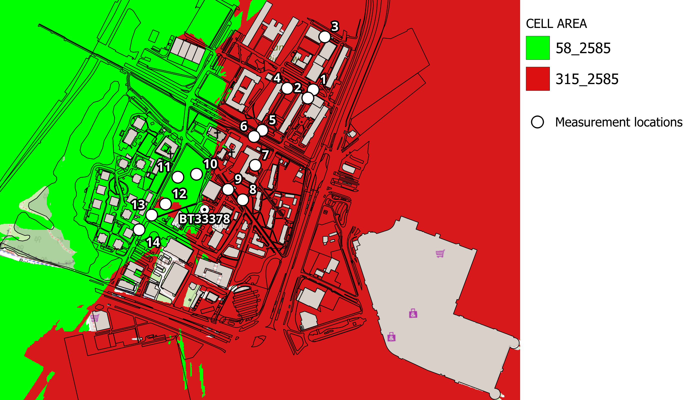 |  | 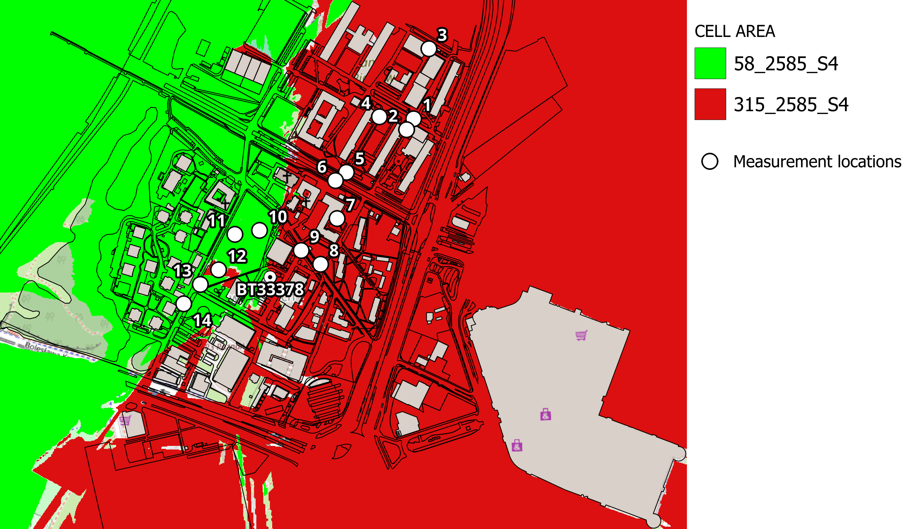 |

### 6.2. Reference Signal Received Power (RSRP)

RSRP measures the average power of LTE reference signals received from a specific cell. It is expressed in dBm and used to evaluate signal strength and coverage. Higher values indicate a stronger signal. RSRP depends mainly on distance, antenna direction, and obstacles.

All three maps show a similar signal distribution. SISO has the highest RSRP values, while MIMO 4×4 has the lowest. This may be related to how the transmit power is divided between antenna elements, even though the total EIRP is almost the same. As expected, the weakest signal appears in the south, where no antenna sector was simulated. The maps also show that the signal is stronger farther from the base station than directly below the antennas. This is probably due to the antenna radiation pattern and downtilt.

| SISO | MIMO 2×2 | MIMO 4×4 |
|:---:|:---:|:---:|
|  |  |  |

#### Comparison with Field Measurements

The RSRP comparison shows that SISO gives the closest results to the measurements, while MIMO 4×4 has the largest differences. All three configurations generally underestimate RSRP. The measured values also vary more than the simulated values.

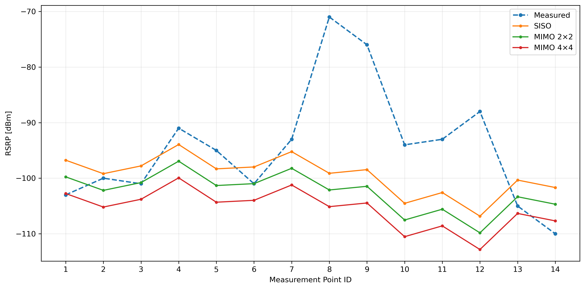

### 6.3. Received Signal Strength Indicator (RSSI)

RSSI measures the total received power in dBm, including the useful signal, interference, and noise. Higher values indicate greater received power, but not necessarily better signal quality. RSSI is also used to calculate RSRQ, which helps evaluate signal quality by comparing the reference signal power with the total received power.

The RSSI maps show almost the same signal distribution as RSRP.

| SISO | MIMO 2×2 | MIMO 4×4 |
|:---:|:---:|:---:|
| 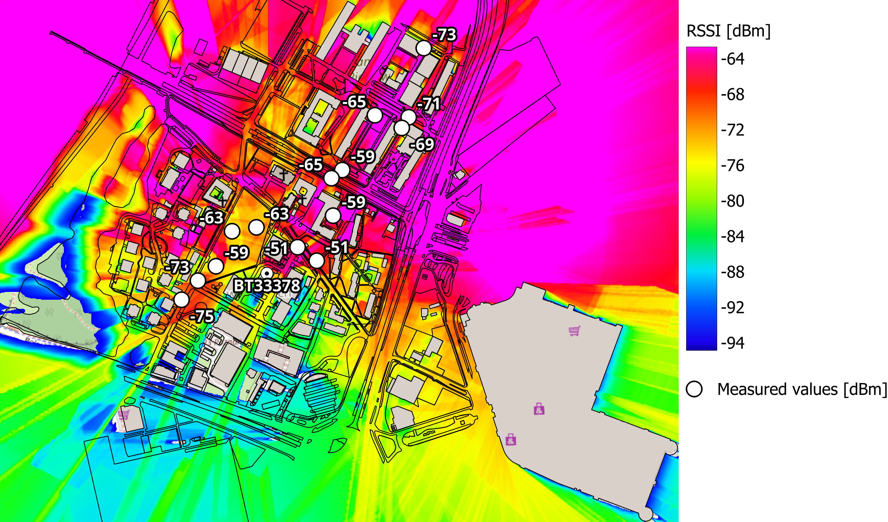 | 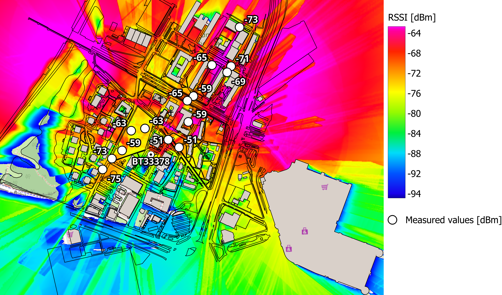 | 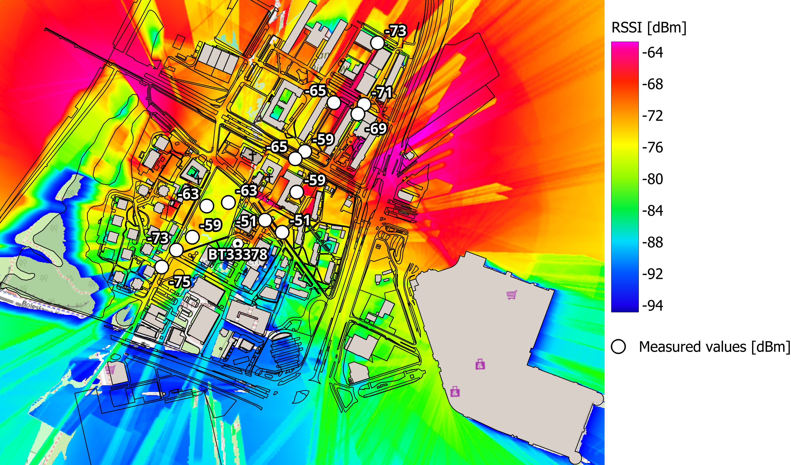 |

#### Comparison with Field Measurements

As with RSRP, SISO gives the closest results to the measurements, while all three configurations generally underestimate RSSI.

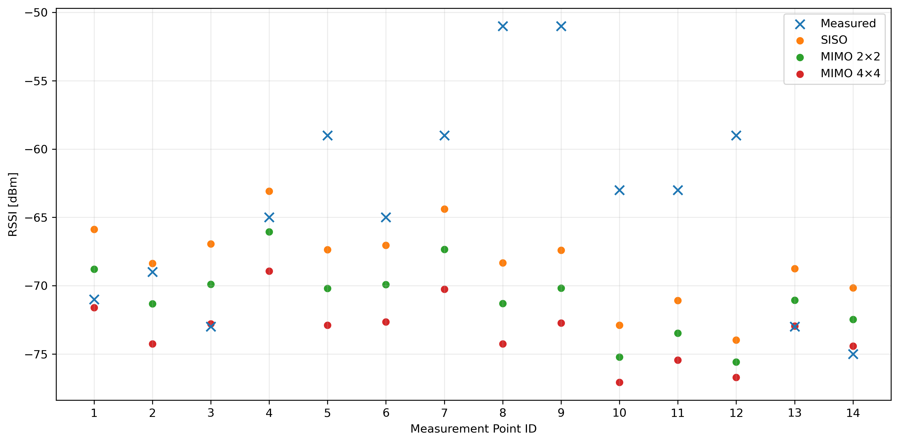

### 6.4. Reference Signal Received Quality (RSRQ)

As mentioned earlier, RSRQ is used to evaluate LTE signal quality. Higher values indicate better quality. It is calculated using RSRP and RSSI:

**RSRQ [dB] = RSRP [dBm] - RSSI [dBm] + 10 × log₁₀(N)**

where N is the number of resource blocks in the measurement bandwidth. A 20 MHz LTE channel contains 100 resource blocks according to the 3GPP LTE standard, so N = 100 when the full channel bandwidth is used for the measurement.

RSRQ is difficult to simulate accurately because the real network load and interference are unknown. However, the maps still show useful differences. All of them show lower RSRQ near the boundary between the two sectors. SISO has larger areas with higher RSRQ, while MIMO 2×2 and MIMO 4×4 show more areas with lower RSRQ, especially near buildings and obstacles.

| SISO | MIMO 2×2 | MIMO 4×4 |
|:---:|:---:|:---:|
| 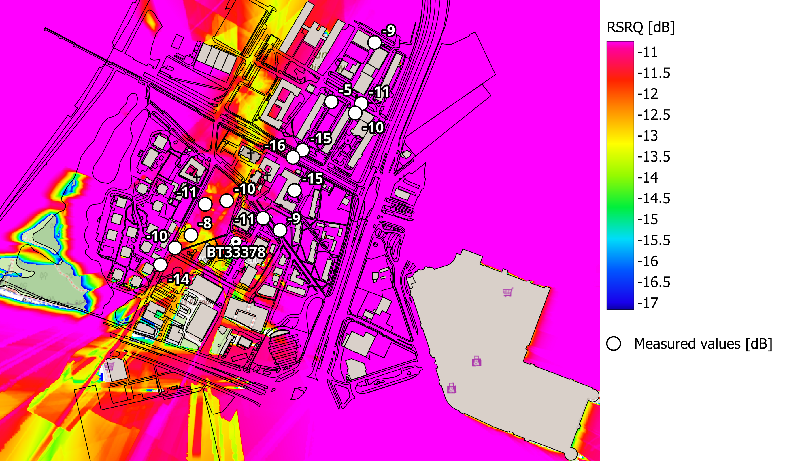 | 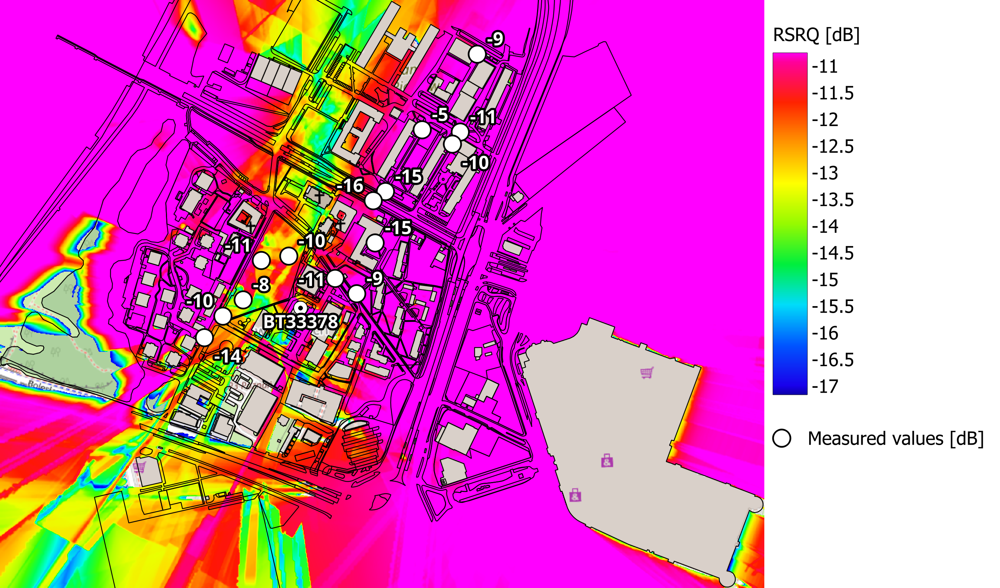 | 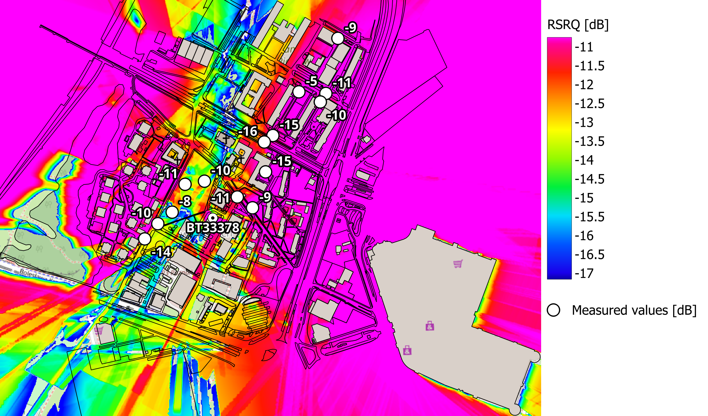 |

#### Comparison with Field Measurements

In this case, the measured RSRQ values again show large variations between locations, and the simulations once again underestimate RSRQ in most cases.

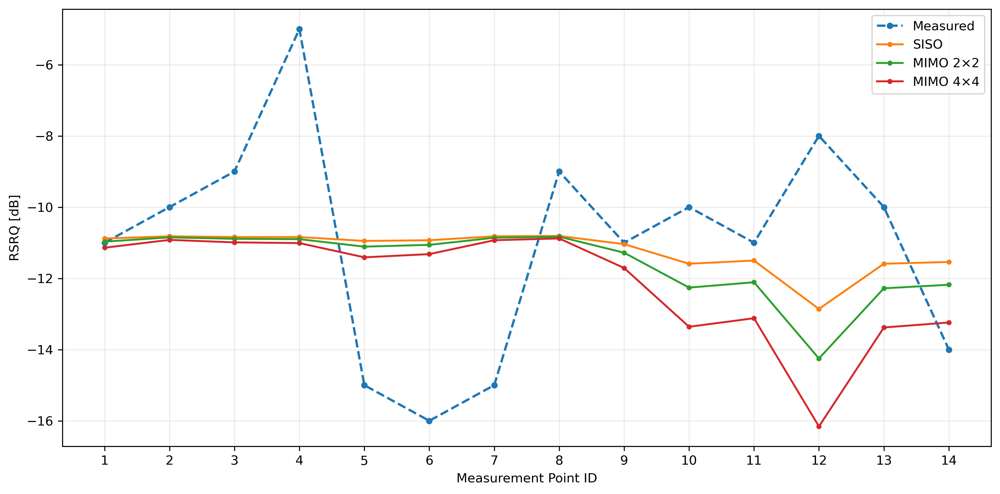

### 6.5. Maximum Downlink Throughput

Maximum Downlink Throughput shows the highest possible data rate from the base station to the user. One of the original LTE design targets, defined by 3GPP, was to achieve peak data rates of around 100 Mb/s in downlink and 50 Mb/s in uplink.

MIMO 4×4 achieved the highest downlink throughput, reaching approximately 226 Mb/s. In comparison, SISO reached only 62 Mb/s. As expected, this difference is mainly due to the use of multiple spatial streams in MIMO, which allows more data to be transmitted simultaneously.

| SISO | MIMO 2×2 | MIMO 4×4 |
|:---:|:---:|:---:|
| 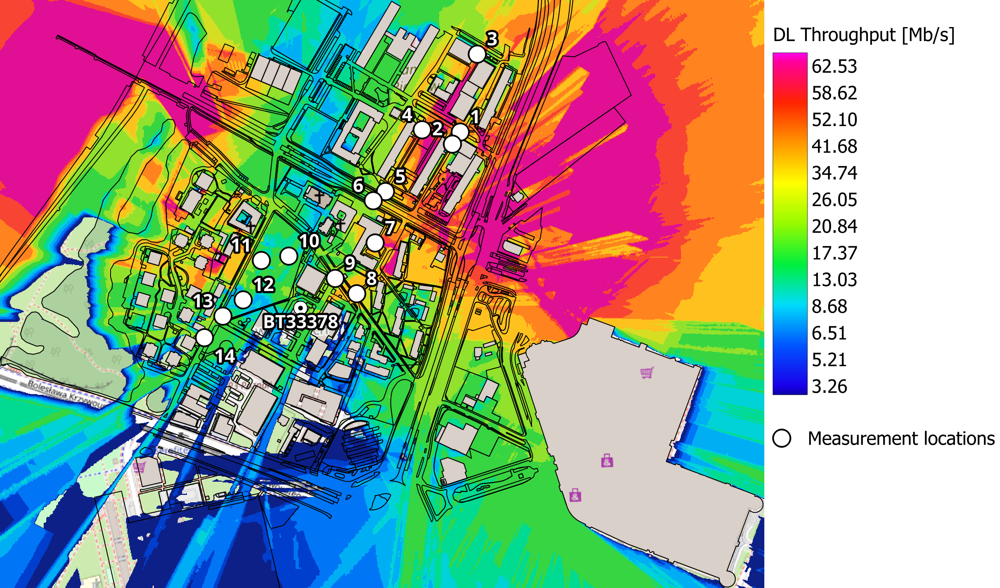 | 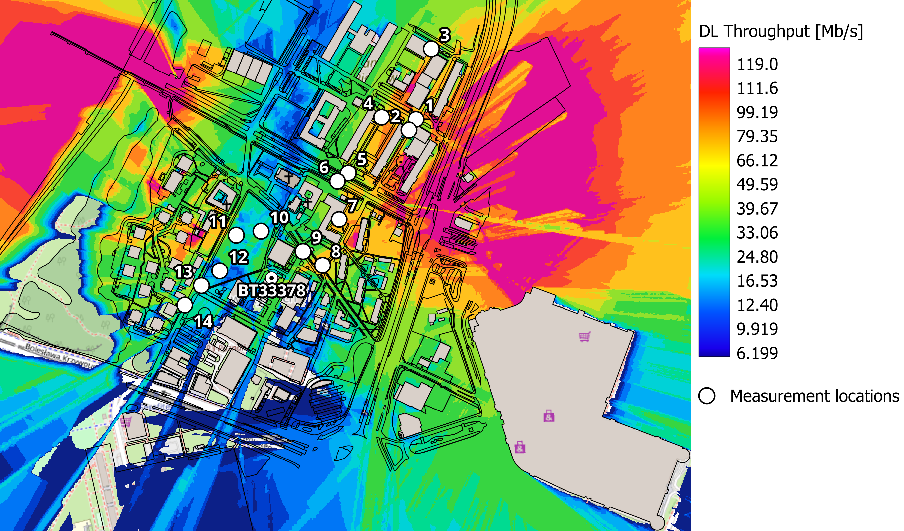 | 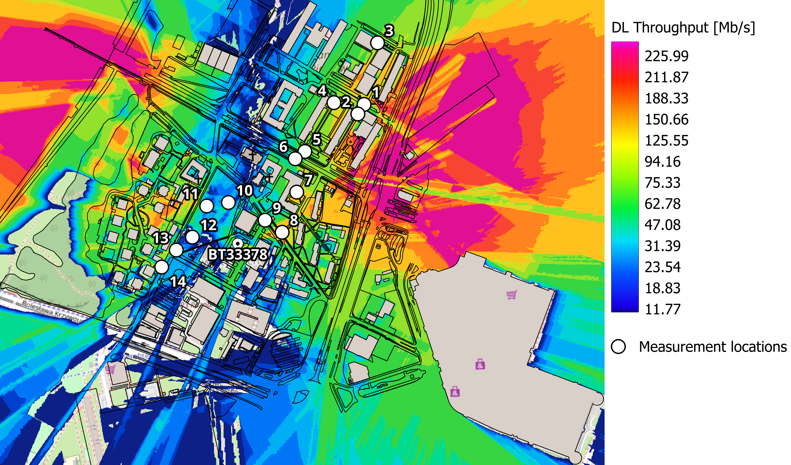 |

### 6.6. Maximum Uplink Throughput

Maximum Uplink Throughput shows the highest possible data rate from the user to the base station.

The results show a similar trend to downlink. MIMO 4×4 achieved the highest uplink throughput, reaching approximately 29.6 Mb/s, compared to 15.6 Mb/s for MIMO 2×2 and 8.2 Mb/s for SISO. However, none of the configurations reached the original LTE uplink target of 50 Mb/s. This may be partly related to the use of TDD, where downlink and uplink share the same frequency band. As mentioned in the 3GPP standard, when TDD is used, the peak data rates for downlink and uplink do not have to be achieved simultaneously.

| SISO | MIMO 2×2 | MIMO 4×4 |
|:---:|:---:|:---:|
| 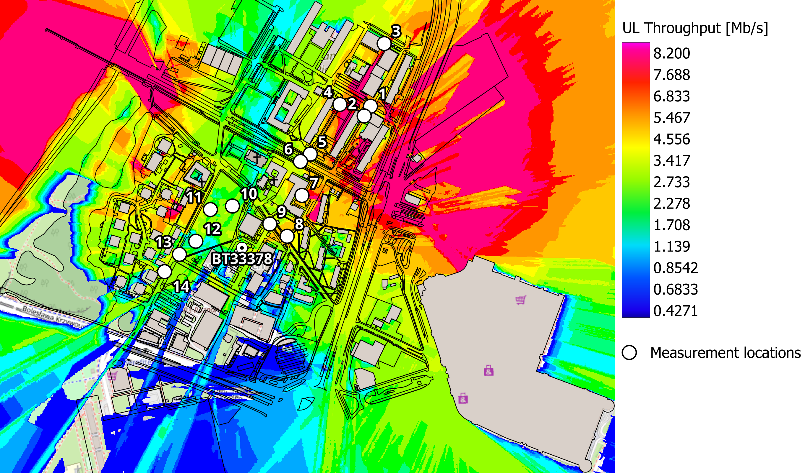 | 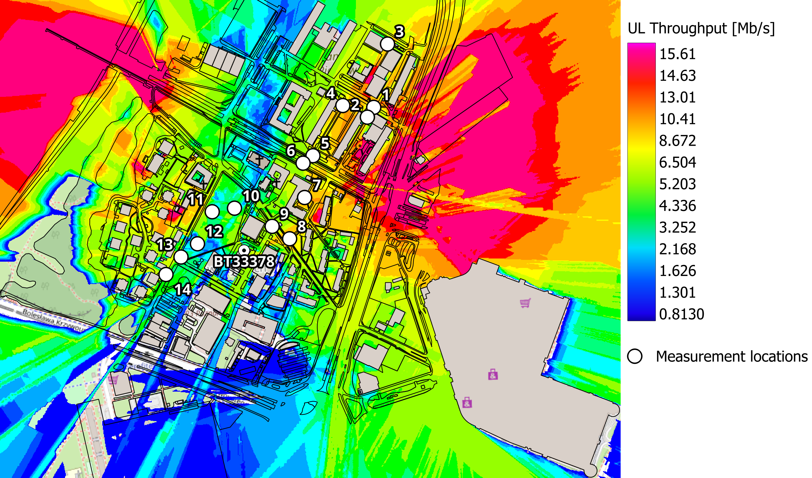 | 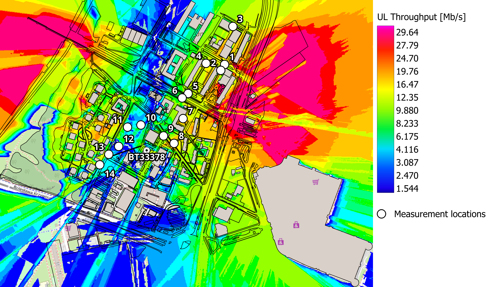 |

## 7. Conclusions

### 1. How well do WinProp simulations match real LTE measurements despite model simplifications?

A direct comparison is not fully reliable because the measurements and simulations do not always use the same LTE cells and frequencies. However, when comparing the results at all measurement points, all three configurations generally underestimate the measured values. This may be because the full configuration of the real network is not known, so not all simulation parameters can be set accurately.

### 2. Which configuration (SISO, MIMO 2×2, or MIMO 4×4) achieves the best simulation results?

MIMO 4×4 achieves the highest downlink and uplink throughput, while SISO provides higher RSRP, RSSI, and RSRQ values. However, the differences in received signal power between configurations may be mainly caused by different EIRP values per antenna element rather than MIMO itself.

### 3. Which configuration (SISO, MIMO 2×2, or MIMO 4×4) gives results closest to real measurements?

SISO gives the closest results to real measurements for RSRP, RSSI, and RSRQ, with the lowest Mean Absolute Error (MAE), which measures the average absolute difference between simulated and measured values.

## 8. Antenna Model Verification and Simulation Limitations

After completing the simulations, I found the technical specifications of the antenna used at the analyzed base station. The antenna model is **[Kathrein 80010651](data/kathrein_80010651_antenna_datasheet.pdf)**.

The specifications confirmed that `WiMax_2500MHz_60deg.apb` was a good choice for the simulations. The model has a horizontal beamwidth of **60°**, compared to **67°** for the real antenna, making it the closest available model in WinProp. The simulated **±45° polarization** was also correct.

However, one difference was found. The real antenna has a gain of **18.5 dBi at 0° tilt**, while **17 dBi** was used in the simulations. If transmit power is set as **Output PA**, antenna gain is added to it, which can affect RSRP. However, in this project, transmit power was set as **EIRP**, which already includes antenna gain. For this reason, the difference does not explain the lower simulated RSRP values.

Regarding the **MIMO configuration**, the Kathrein 80010651 supports **MIMO 2×2** and can also be used for **SISO**. However, **MIMO 4×4** requires additional antenna elements, so the MIMO 4×4 simulation results can only be treated as a theoretical scenario rather than a representation of the installed antenna.
